<p align="center"></p>

# Prior Day Breakout (MetaTrader 5 and MetaTrader 4)

A free Expert Advisor that trades the **previous-day high/low breakout** on **XAUEUR**: on a closed bar, the first close
above yesterday's high is a buy, the first close below yesterday's low is a sell, once per side per day, with the stop at
the other side of yesterday's range and a fixed target. Fixed 0.01 lot. Source for both editions, a Python statement of
the rule, the tests, and the honest backtest evidence, which is **thin**.

**Website:** [allanninal.dev/mql5 (Expert Advisors)](https://www.allanninal.dev/mql5/#eas) · [MT4 editions](https://www.allanninal.dev/mql5/#mt4) · [allanninal.dev](https://www.allanninal.dev)
· **Contact:** message me on [LinkedIn](https://www.linkedin.com/in/allanninal/).

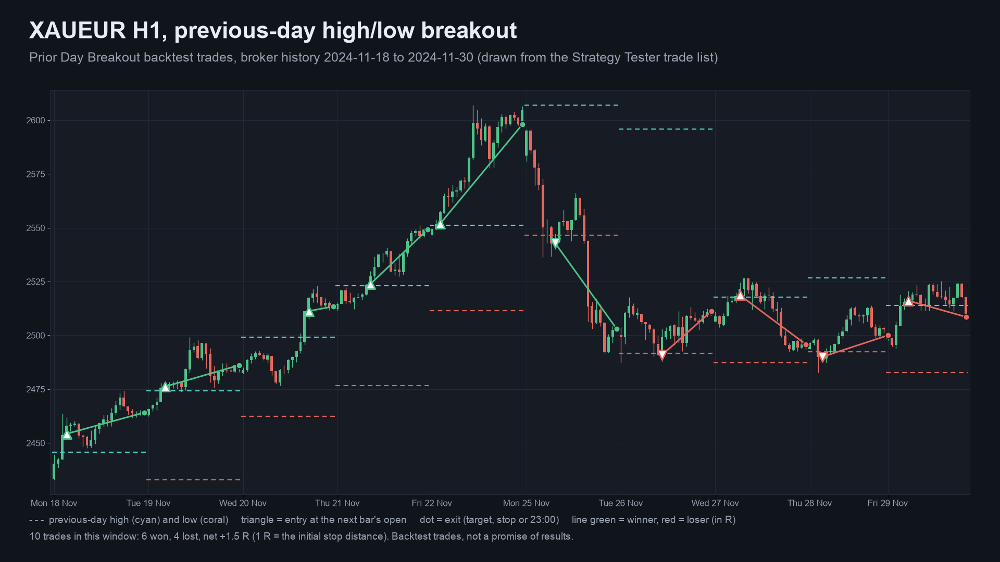

> This EA promises no profit. Every number here is a backtest on broker history, not live trading, and the evidence is
> weak (see [What the backtest does and does not show](#what-the-backtest-does-and-does-not-show)).

## Get it on the MQL5 Market

| Edition | Platform | Price | Link |
|---|---|---|---|
| Prior Day Breakout | MT5 | free | <https://www.mql5.com/en/market/product/201959> |
| Prior Day Breakout MT4 | MT4 | free | MT4 edition: coming soon on the MQL5 Market |
| Prior Day Breakout Pro | MT5 | paid | <https://www.mql5.com/en/market/product/201963> |
| Prior Day Breakout Pro MT4 | MT4 | paid | MT4 edition: coming soon on the MQL5 Market |

The Market builds are the same code as the source in this repository. The Pro edition is a separate, paid product that is
**not** part of this repository (see [Free vs Pro](#free-vs-pro)).

## Contents

1. [What it is and who it is for](#what-it-is-and-who-it-is-for)
2. [Why it was built](#why-it-was-built)
3. [How it works](#how-it-works)
4. [What the backtest does and does not show](#what-the-backtest-does-and-does-not-show)
5. [How it was tested](#how-it-was-tested)
6. [Architecture](#architecture)
7. [Inputs, presets, install and compile](#inputs-presets-install-and-compile)
8. [Run the Python reference and the tests](#run-the-python-reference-and-the-tests)
9. [Honest limits](#honest-limits)
10. [Free vs Pro](#free-vs-pro)
11. [Licence](#licence)

## What it is and who it is for

**What:** a mechanical, once-a-day breakout rule. Levels are the high and low of the previous trading day. A buy needs a
bar to close above the high, a sell a close below the low. The EA sends a market order at the next bar's open, puts the
stop at the other side of yesterday's range, the target at a fixed multiple of that distance (R), and closes whatever is
open at 23:00 server time. One position at a time. The panel shows the rule, the preset status, the levels, the last signal
and the open position.

**Live safety gate:** live, the EA opens orders only on the two **validated presets** (XAUEUR H1 with target 2 R, XAUEUR M15
with target 1 R). On any other symbol, timeframe or target the panel reads "not validated" and no orders are sent. The
Strategy Tester accepts any symbol, so the MQL5 Market validator can run it.

**For:** traders who want this exact rule automated and are willing to read the evidence below first. Also for developers
who want a small, tested EA example with a Python statement of its rule.

**Not for:** anyone looking for a proven edge. There is none shown here.

| | |
|---|---|
| 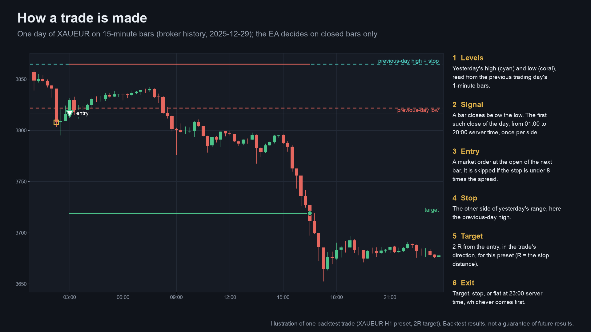 | 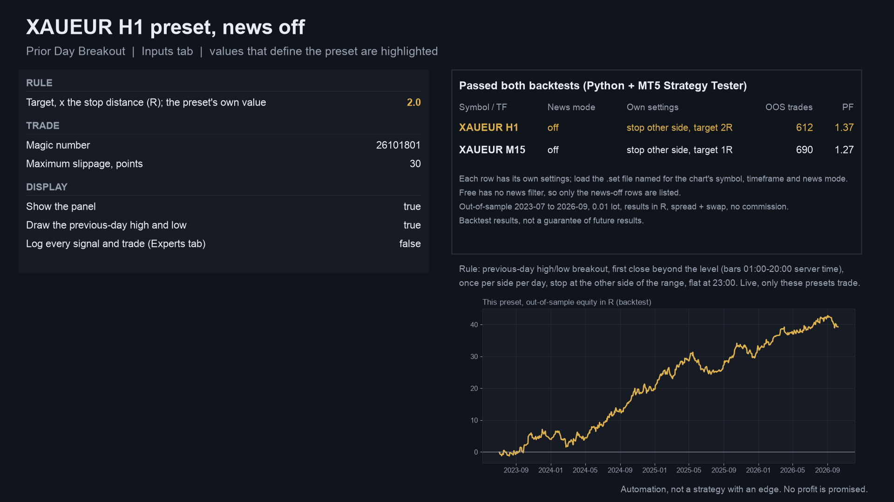 |
| 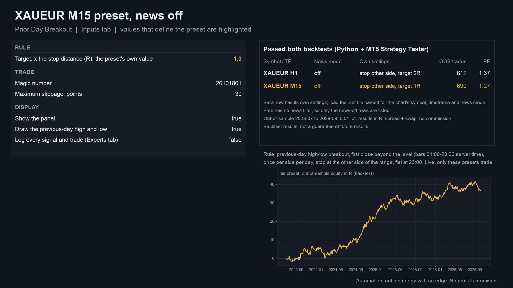 | 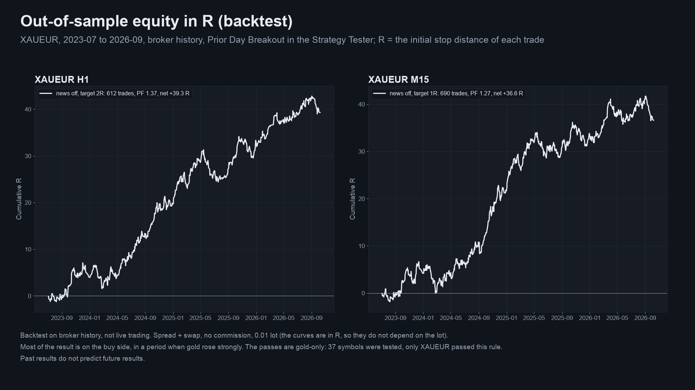 |

Image notes: the charts and equity curves are drawn from broker history and the Strategy Tester trade lists by a script, and
the input screens are generated from the `.set` values; they are illustrations, not terminal captures. MT4 versions are in
[`docs/images/mt4/`](docs/images/mt4).

## Why it was built

The motivations, stated with the evidence we actually have:

- **It came out of a screen, not out of a belief.** The rule was one of the combinations in a pre-registered strategy
  screen (37 symbols, several timeframes, in-sample 2020-01 to 2023-06, out-of-sample 2023-07 to 2026-10). It was the only
  combination that passed both the Python backtest and the MetaTrader 5 Strategy Tester, so the EA ships for that symbol
  and those timeframes only.
- **Weak demand, stated plainly.** No demand research backs this specific rule. Breakout EAs are plentiful on the MQL5
  Market, and this one exists because it passed the gates, not because buyers asked for it. It is a free, transparent
  reference implementation.
- **Provable behaviour.** The rule is written down in [`tests/reference.py`](tests/reference.py) and compared with the EA's
  own trades, entry for entry.

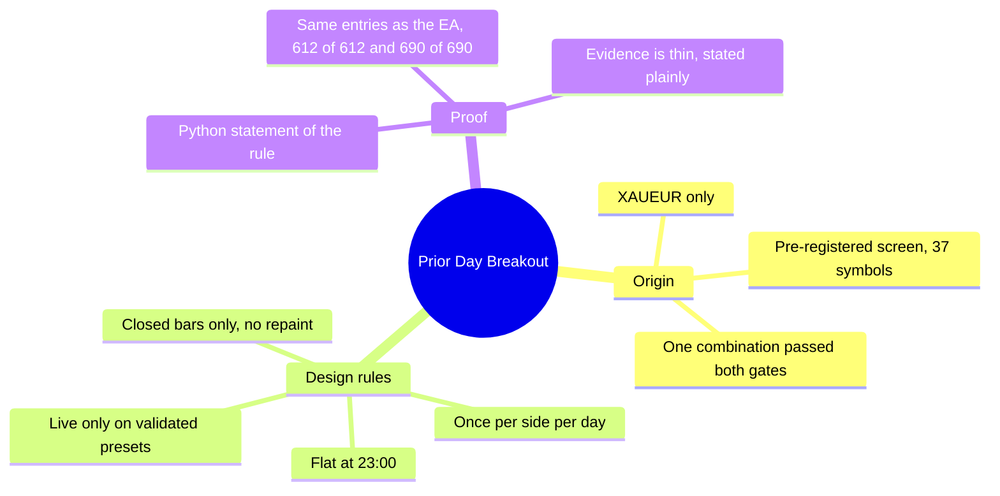

## How it works

### The rule, step by step

Times are the broker's server clock (the tests used UTC+2, UTC+3 in US summer time). `H` and `L` are the previous trading day's
high and low, taken from 1-minute bars of the latest earlier day that has bars (up to 7 days back).

1. **Levels.** At the start of the day, `H = max(high)` and `L = min(low)` of the previous trading day.
2. **Signal.** On each closed chart bar that opened at or after 01:00: a **buy** if `close > H` and no buy has fired today; a
   **sell** if `close < L` and no sell has fired today. The side is used up even if the entry turns out to be disallowed.
3. **Entry window.** The order is sent at the open of the next bar, only if that bar opens before 20:00 of the same day and
   no position is open.
4. **Fill and stop.** A buy fills at the ask, a sell at the bid. The stop is the other side of the range: `L` for a buy, `H`
   for a sell. The stop distance is `sd = (fill - stop) x side`.
5. **Skip.** The trade is skipped if `sd` is not positive or is under 8 times the entry spread, or if the stop would lose more
   than 50% of equity at 0.01 lot, or if free margin is short.
6. **Target.** `fill + side x R x sd`, with `R` the preset's target (2 on H1, 1 on M15).
7. **Exit.** Target, stop, or flat at 23:00 server time (at the first tick after 23:00 if the market is closed then).

The lot is fixed: 0.01, or the broker's minimum lot when that is larger. After a restart the EA replays today's closed bars,
so a side that already fired today is not taken again.

### Per-bar algorithm

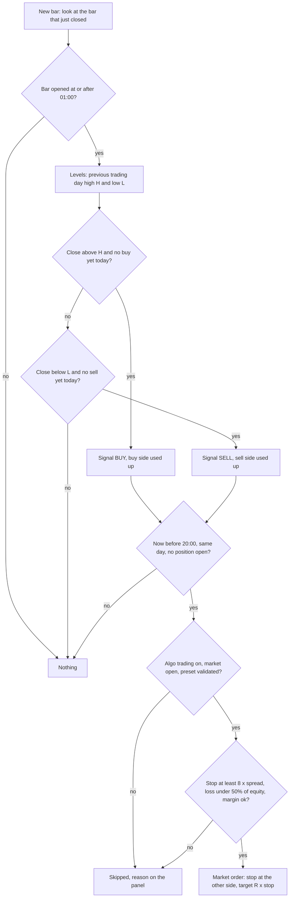

### Day cycle

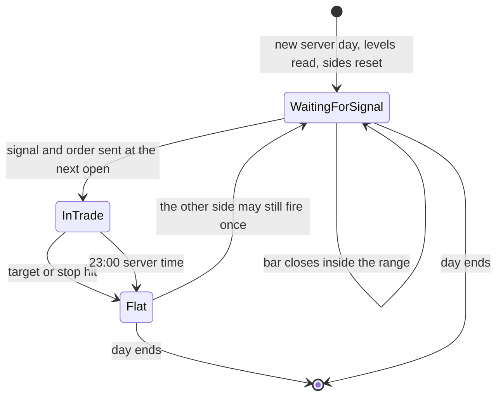

### One trading day

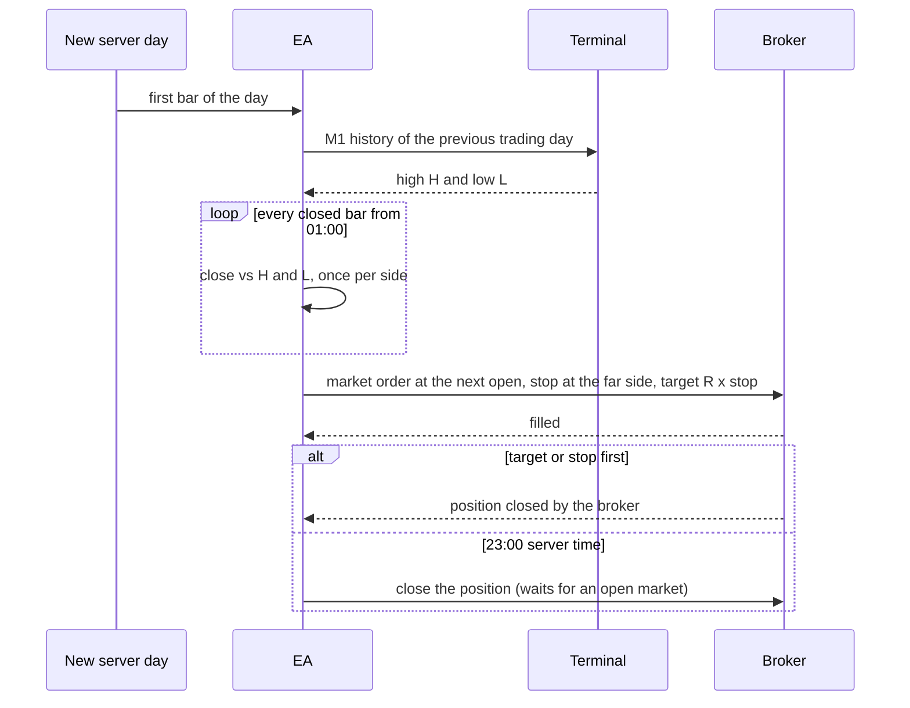

## What the backtest does and does not show

All numbers are the **Strategy Tester run of the EA itself** (1-minute OHLC, XAUEUR, 0.01 lot, results in R where R is the
stop distance of each trade, spread and swap included, no commission), out of sample 2023-07-01 to 2026-10-09, settings
frozen on 2020 to mid-2023 data first. Source: [`tests/results/oos-summary.md`](tests/results/oos-summary.md).

| Preset | Target | OOS trades | Profit factor | net R | t | max drawdown (R) |
|---|---:|---:|---:|---:|---:|---:|
| XAUEUR H1 | 2 R | 612 | 1.37 | 39.3 | 2.91 | 6.9 |
| XAUEUR M15 | 1 R | 690 | 1.27 | 36.6 | 2.47 | 6.7 |

Reading them with care, as the screen's own write-up does:

- **One idea in two forms.** The two presets share most of their trades.
- **Chance-level evidence.** Of 392 judged units over 37 symbols, 8 passed nominally against 8.3 expected from chance alone,
  and none survives the Holm multiple-testing correction (smallest adjusted p 0.33). XAUUSD with the same rule is just under
  the bar; the FX pairs and crypto fail.
- **Mostly buys, in a gold rally.** Gold rose about 110% over the out-of-sample period. The buy side earned 35 to 37 R, the
  sell side 1 to 2 R.
- **Small per-trade edge.** In-sample profit factors were only 1.05 to 1.09; win rate about 52%, average win 0.46 R,
  average loss 0.36 R, about +0.06 R per trade, so costs matter and commission was not modelled.

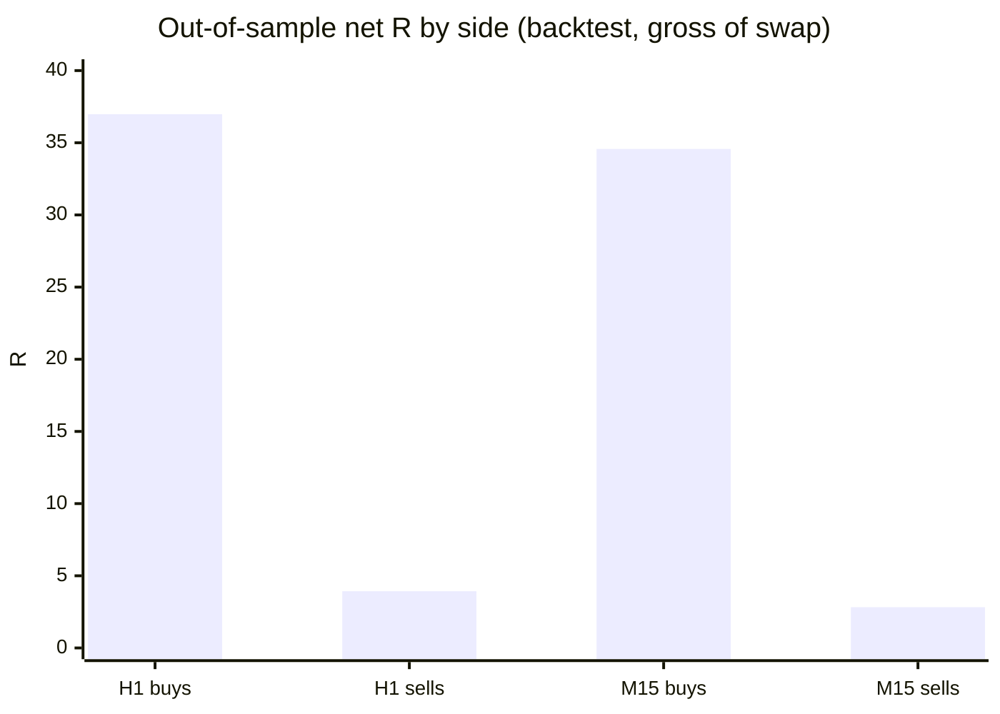

Source: [`tests/results/quarterly-gross-r.json`](tests/results/quarterly-gross-r.json), the reference run (gross R, before swap, so
slightly above the net R in the table).

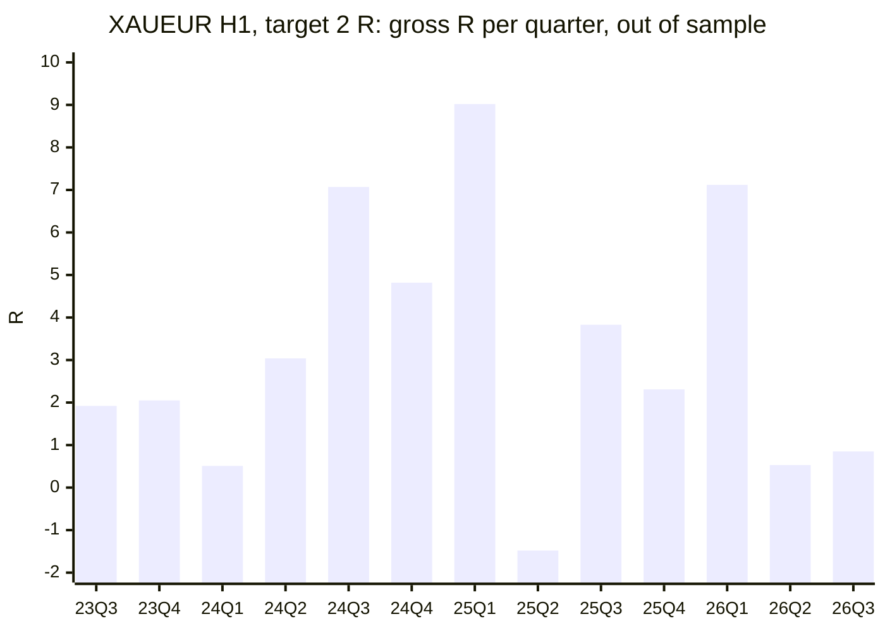

(26Q4 holds 3 trades, -0.68 R, and is left out of the chart.)

## How it was tested

| Check | Result |
|---|---|
| Rule invariants on synthetic data, 60 runs, 1,931 trades ([`tests/check_reference.py`](tests/check_reference.py)) | PASS, 0 violations |
| Reference vs the EA in the MT5 Strategy Tester, XAUEUR H1, 2023-07 to 2026-10 | 612 of 612 entries identical (time and side) |
| Reference vs the EA in the MT5 Strategy Tester, XAUEUR M15 | 690 of 690 entries identical |
| Reference vs the EA, same exit minute | 521 of 612 (H1), 502 of 690 (M15): the tester builds its own tick path from M1 bars |
| Reference vs the research simulation the presets were selected with | 612 of 612 and 690 of 690 trades identical, exits and exit prices too (largest difference 0.0) |
| MT4 edition vs the simulation (MT4 Strategy Tester, every tick, fixed 25-point spread) | same trade counts (612 and 690); entries match on 99.84% and 99.86% |
| MT5 release check (memory, speed, non-repainting, validator-style runs) | PASS: 364 MB, 1 min 21 s for 52 M ticks, 142 signals identical on every tick and on 1-minute OHLC, 0 error lines |
| MT5 and MT4 editions compiled with MetaEditor (clean scratch folder, only this repository's files) | 0 errors, 0 warnings each |
| MT5 Market build | passed the MQL5 Market's automated product validation before publication (the Market's own check) |

Sources: [`tests/results/`](tests/results). Full tables, including the MT4 gate and the release check, are in
[`tests/results/oos-summary.md`](tests/results/oos-summary.md).

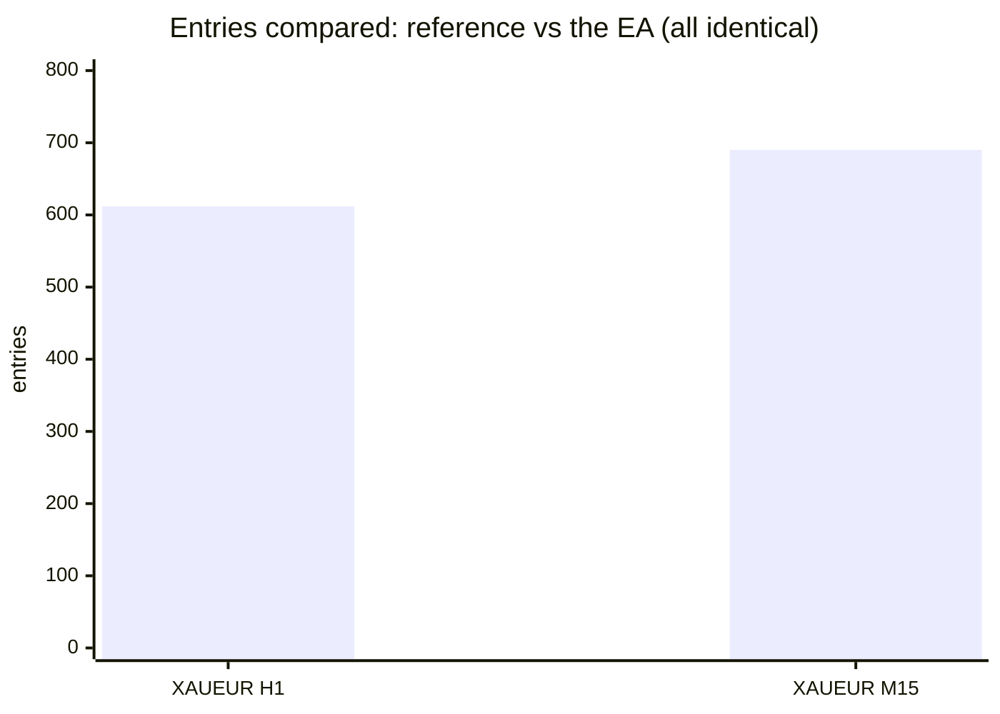

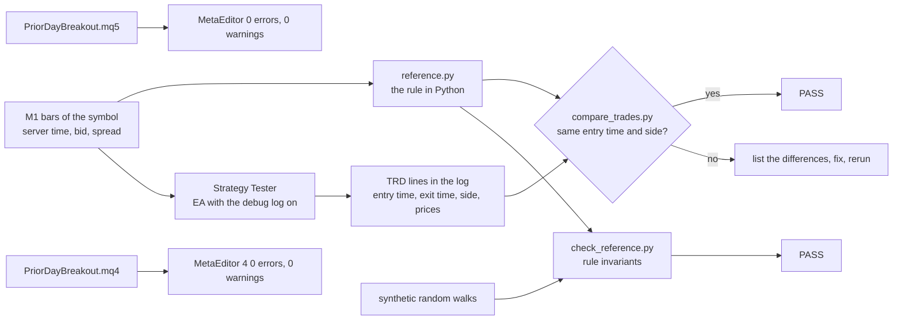

**Not covered:** forward (live) trading, commission and slippage, and tick-level fills (the tests use 1-minute OHLC for MT5
and a fixed 25-point spread for MT4). The tester and live behaviour of the preset refusal on other symbols is by design and
was read, not run live. The reference is not a bit-for-bit copy of the tester's fills: only entries are compared exactly.

## Architecture

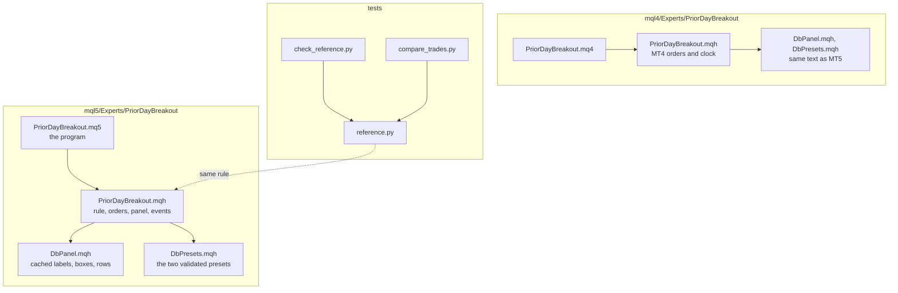

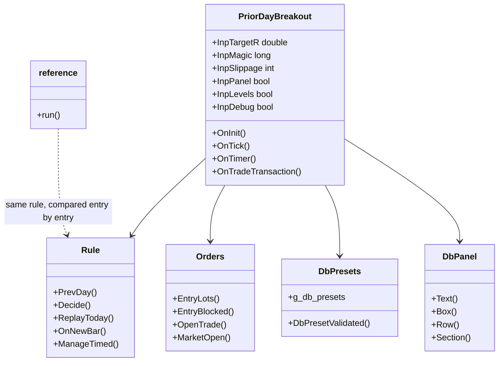

## Inputs, presets, install and compile

| Input | Default | Meaning |
|---|---|---|
| Target, x the stop distance (R) | 2.0 (1.0 on M15) | the preset's own value; live, other values are refused |
| Magic number | 26101801 | identifies this EA's position |
| Maximum slippage, points | 30 | order deviation |
| Show the panel | true | rule, preset status, levels, signal, position |
| Draw the previous-day high and low | true | dotted lines across the current day |
| Log every signal and trade (Experts tab) | false | prints signals and one `TRD` line per closed trade |

Preset files (inputs only): [`presets/`](presets) (MT5) and [`presets/mt4/`](presets/mt4). Load the file that matches the
chart's timeframe.

**Install from source.** Copy the `mql5/Experts/PriorDayBreakout` folder into `<terminal data folder>/MQL5/Experts/` (MT5) or
the `mql4/Experts/PriorDayBreakout` folder into `<data folder>/MQL4/Experts/` (MT4). Open `PriorDayBreakout.mq5` or `.mq4`
in MetaEditor and press Compile (F7). Both compile with 0 errors and 0 warnings. Keep the files of each edition together:
the program includes `PriorDayBreakout.mqh`, which includes `DbPanel.mqh` and `DbPresets.mqh` from its own folder.

**Run it.** Open an XAUEUR chart (a prefixed or suffixed name is fine) on H1 or M15, attach the EA, keep Algo Trading (MT5) or
AutoTrading (MT4) on. The tests used a server clock of UTC+2 (UTC+3 in US summer time); the 01:00 to 20:00 window follows
your server clock, so check that it matches. Minimum balance suggested by the Market listing: 1,500 USD at 0.01 lot
(recommended 3,000 USD); the out-of-sample backtest's largest drawdown at 0.01 lot was 673 USD and the largest single loss
373 USD. These are backtest figures, not a limit on future losses.

## Run the Python reference and the tests

```bash
python3 -m venv .venv && . .venv/bin/activate && pip install -r requirements.txt
python3 tests/check_reference.py                 # synthetic data, no broker history needed; prints PASS or FAIL
```

```python
import sys; sys.path.insert(0, "tests")
from reference import run
# m1: pandas DataFrame indexed by server time with open, high, low, close (bid) and spread (price units)
trades = run(m1, tf_minutes=60, target_r=2.0)     # one row per trade, gross of swap
```

To repeat the entry comparison on your own data:

1. Run the EA in the Strategy Tester with "Log every signal and trade" on, on your XAUEUR history.
2. Export the symbol's M1 bars to a CSV with the header `time,open,high,low,close,spread` (server time, bid, spread in price units).
3. `python3 tests/compare_trades.py <log file> <m1.csv> --tf 60 --target 2.0 --from 2023-07-01` lists the entries both share and
   those only one of them has.

The broker price history and the EA's trade lists used for the published numbers are not in this repository.

## Honest limits

- **No edge is shown.** The evidence is a single 3.3-year window in one gold regime, with 8 nominal passes where 8.3 were
  expected by chance. Treat the EA as unproven automation.
- **Mostly buys.** The result depends on the buy side in a period of rising gold.
- **Costs.** Commission and slippage are not modelled; the swap is from the broker's sheet at the time; the test ticks are
  1-minute OHLC.
- **XAUEUR is offered by few brokers.** The EA refuses live orders on other symbols and timeframes (the tester accepts any).
- **Server clock.** The entry window and the 23:00 exit follow the broker's server time, not UTC.
- **Settings were chosen by in-sample profit factor only,** and no walk-forward test was run.
- **MetaTrader 4 has no economic calendar and a different tick model**; the MT4 edition's numbers come from its own tester
  run on a fixed spread.
- No profit or accuracy claim is made.

## Free vs Pro

| | Free: Prior Day Breakout | Paid: Prior Day Breakout Pro |
|---|---|---|
| Platforms | MT5 [201959](https://www.mql5.com/en/market/product/201959), MT4 coming soon | MT5 [201963](https://www.mql5.com/en/market/product/201963), MT4 coming soon |
| Price | free | paid (see the Market page) |
| What you get | the rule above, fixed 0.01 lot, XAUEUR H1 and M15 presets | the same rule with risk-based sizing, news modes, spread and Friday filters, as described on its Market listing |
| Source | this repository | not published |

No need to buy the paid product to use the free one: the free EA is complete on its own.
Website: [allanninal.dev/mql5](https://www.allanninal.dev/mql5/#eas) ([MT4](https://www.allanninal.dev/mql5/#mt4)).

## Licence

Everything in this repository is © 2026 Allan Niñal under the
[PolyForm Noncommercial License 1.0.0](LICENSES/PolyForm-Noncommercial-1.0.0.md): source-available, free for personal and
other noncommercial use, not for commercial use. Each source file has an `SPDX-License-Identifier` line. Text:
[`LICENSE`](LICENSE). The previous-day high/low breakout is a public idea; this is an independent implementation. The licence
applies to this source, not to anything you build or trade with the EA. Trading involves risk; the software is provided as is.

---

**Website:** [allanninal.dev/mql5](https://www.allanninal.dev/mql5/#eas) · [MT4](https://www.allanninal.dev/mql5/#mt4) · [allanninal.dev](https://www.allanninal.dev)
· Questions: message me on [LinkedIn](https://www.linkedin.com/in/allanninal/).
